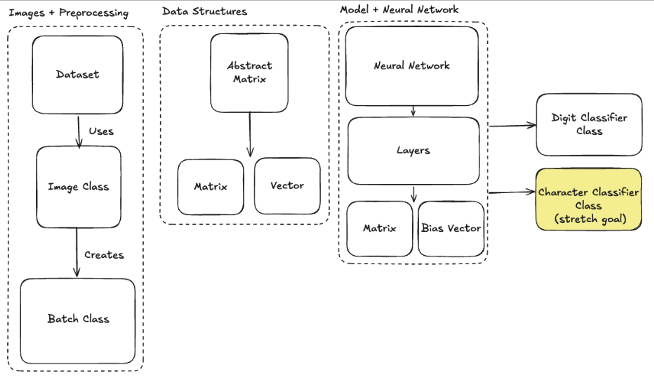

# CS331 Optical Character Recognition

This group project was made for CS 33100 Introduction - C++ and Object Oriented Programming at Perdue University Fort wayne.

## Class Structure

**Note**: In our final version of the project, we decided to exclude the `Batch class` and `Digit Classifier Class`.

Throughout our project, our plan only changed a small amount from our initial class diagram we showed during the initial project proposal. Vector was made to extend Matrix, and abstractMatrix was removed. Also a file called FileUtil was added, that added basic utilities for common tasks we had when reading from file. FFtrain class, for training the neural network, was also added.

## Executables and How to Use

The minimal version of the system is composed of **two programs**: `Classify` and `Train`. 

Classify is a command line program that takes in a specially formatted image file and uses a trained neural net in the form of a proprietary formatted weights file, also provided with the program, to identify the digit in that image. The program will also return a confidence value associated with how certain it is that its output is correct. 

`./output_folder/classify <image-path> <weights-path>`

Train is a command line program that takes in the MNIST dataset and trains a neural net using backpropagation. It allows the user to see training metrics after each epoch, such as the loss value and validation accuracy, and saves the weights of the neural net as a file which Classify can use. 

`./output_folder/train <training-images-path> <training-labels-path> <testing-images-path> <testing-labels-path>`

Over the course of the project, we also added Extract, which takes the images in MNIST dataset file and extracts them into visible images.

`./output_folder/extract <dataset-folder> <output-folder> [max-images]`

## Getting Training Files

To access the training/testing files, navigate to this link: [Data folder](https://drive.google.com/drive/folders/1RleY5RVBo5wI2HtsoAUC3FjjjgHWKaQt?usp=sharing).

Create a `./data` in the root project directory and copy all of these binaries over.

## Build Instructions

This project uses cmake. To build, create a folder for output files. We called this folder 'build'.

run `cmake -S . -B output_folder` to do initial cmake generation for first-time setup, then, to build the project, run `cmake --build output_folder`

Output executables should be found somewhere in output_folder, depending on the build system cmake decided to use.